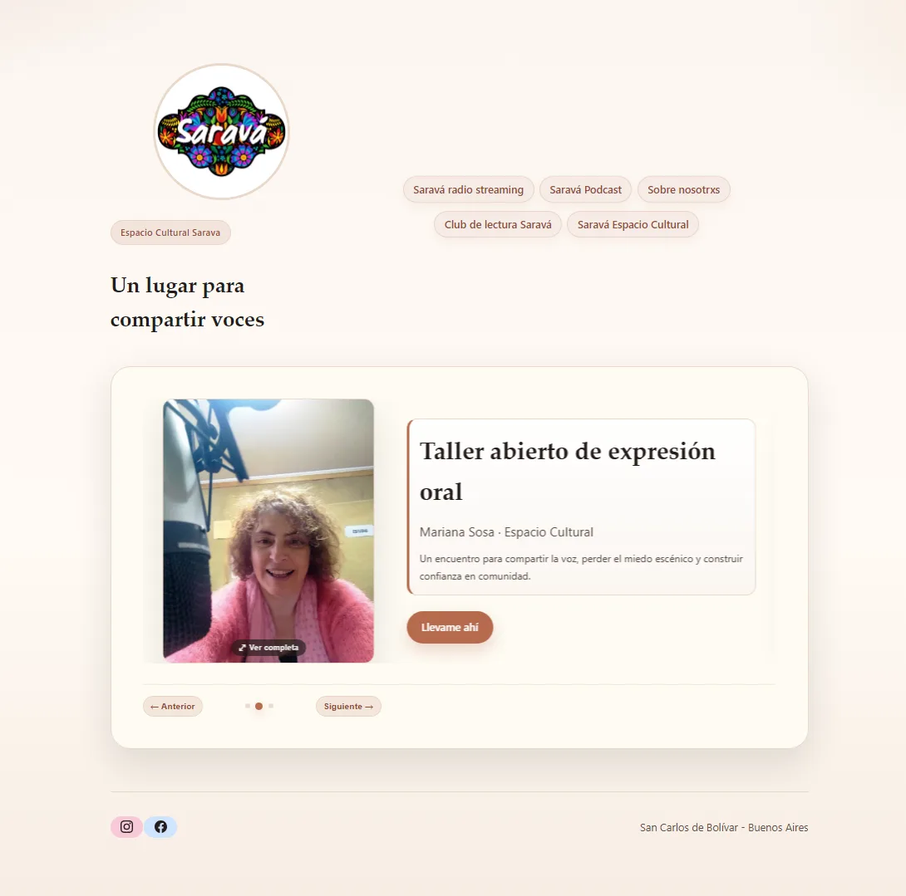
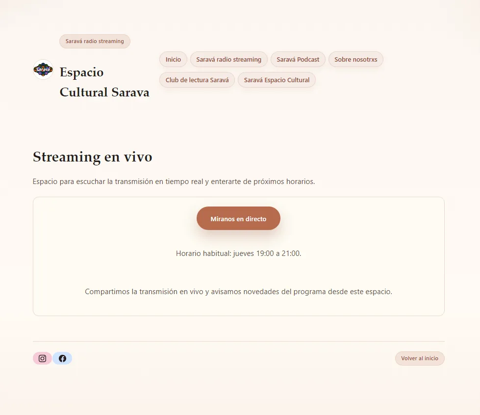
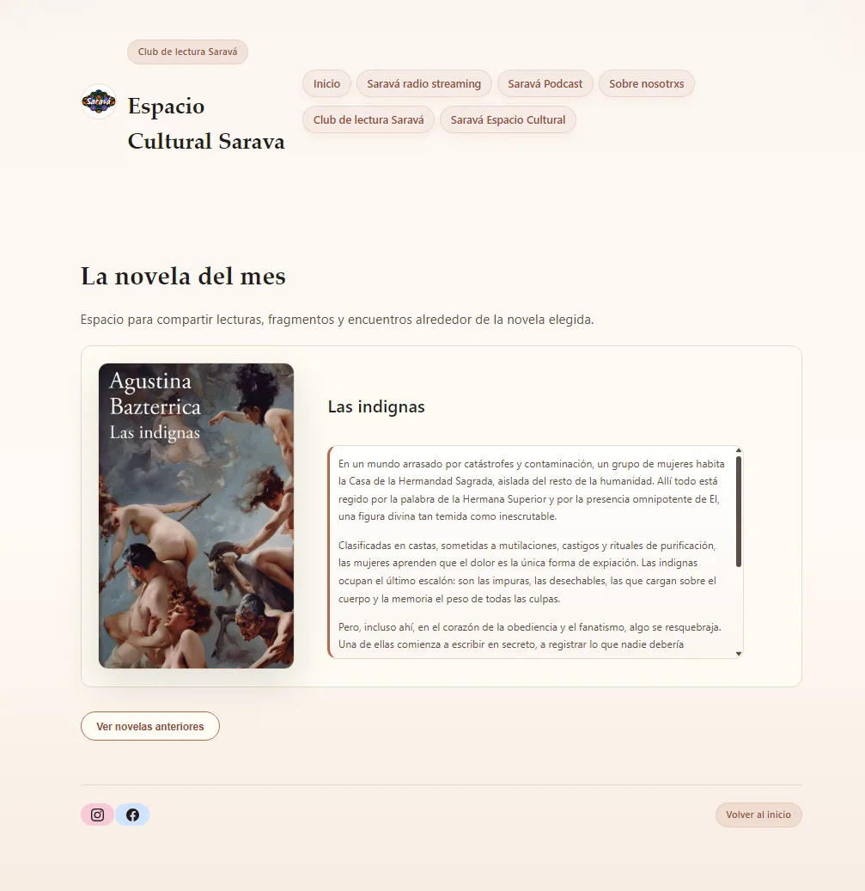
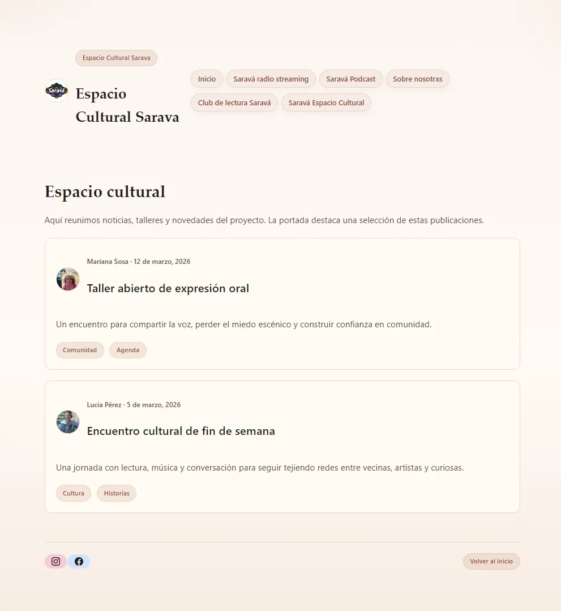

# Saravá: Espacio Cultural Saravá

[](.github/workflows/ci.yml) [](https://sarava-radio-streaming.vercel.app)

**Real client site** for Espacio Cultural Saravá (San Carlos de Bolívar, Buenos Aires): radio, podcast, book club, cultural posts, and a **Clerk-gated admin CMS** so editors publish without touching Git.

**Live:** [sarava-radio-streaming.vercel.app](https://sarava-radio-streaming.vercel.app)

## Screenshots

| Home | Radio | Club de lectura | Espacio cultural |
|:---:|:---:|:---:|:---:|
|  |  |  |  |

## Problem

The collective needed a public site they could keep updating without a developer in the loop. Editors manage posts, events, novels, about/team, logo, and images from `/admin`.

## What it shows

- Public sections: home, radio, podcast (Spotify), club de lectura, espacio cultural, sobre nosotrxs
- Admin CMS with Clerk allowlist (`ADMIN_EMAIL`)
- Neon + Prisma for content; Vercel Blob for uploads with admin previews
- Reader comments on posts, active novel, radio, and podcast
- Featured-only adaptive home hero
- Spanish UI throughout; CI for lint, content validation, and production build

## CMS and publishing model

- The public site reads CMS content from Postgres and renders it on demand, so
	editors can update posts, events, novels, team information and site settings
	without changing Git-tracked files.
- Clerk authentication routes allowlisted admin emails to `/admin`; all other
	signed-in users return to the public home. Admin controls are also gated by
	the server-side allowlist rather than only hidden in the UI.
- Novel drafts are restored only for new or unpublished content. Published edits
	discard stale drafts so an old local draft cannot overwrite published data.
- Upload previews support both local blob URLs and stored remote/public paths.
	Uploads are capped at 4.5 MB to stay below typical serverless request limits.
- The hero ignores legacy stock placeholders and uses only explicitly active
	featured novels. An inline theme boot script prevents a flash of the wrong
	palette during reloads.

## Stack

- Next.js 16 (App Router), React 19, TypeScript, Tailwind CSS 4
- Clerk, Prisma + Neon Postgres, Vercel Blob
- Hosted on Vercel

## Run locally

```bash
npm install
cp .env.example .env.local
# Clerk, DATABASE_URL, BLOB_READ_WRITE_TOKEN, ADMIN_EMAIL
npx prisma migrate dev
npm run db:seed   # optional demo content
npm run dev
```

Open [http://localhost:3000](http://localhost:3000).

```bash
npm run ci    # lint + validate:content + build
```

Env reference: [`.env.example`](./.env.example).
